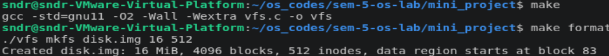
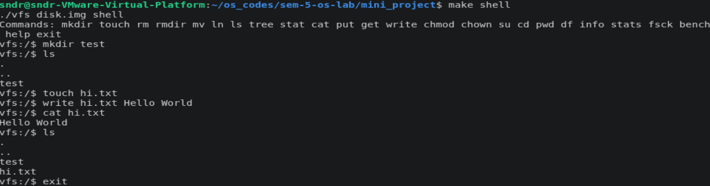
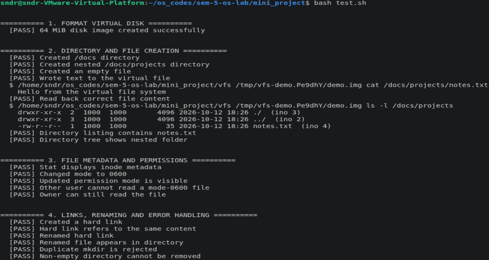
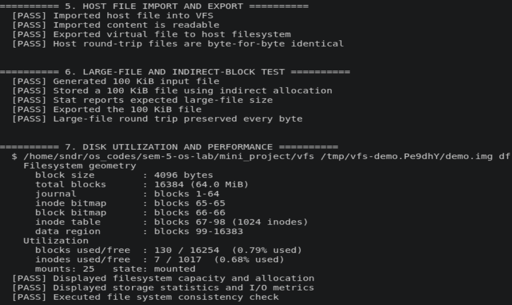
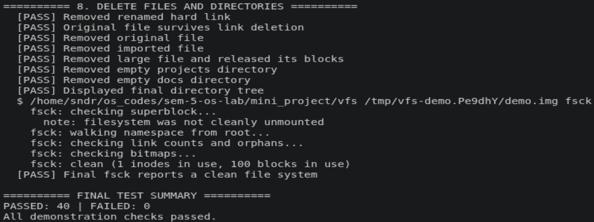
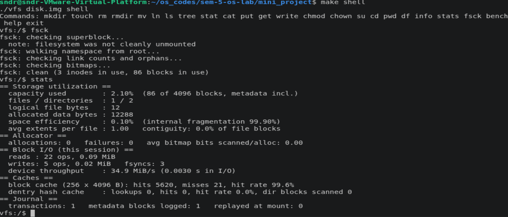

# LinuxFS Emulator

**A Linux-inspired, inode-based virtual filesystem built from scratch in C.**

LinuxFS Emulator is a command-line filesystem implementation that stores files and directories inside a persistent virtual disk image. It reproduces fundamental filesystem mechanisms—block and inode allocation, hierarchical directories, permissions, hard links, caching, metadata journaling, and recovery—without modifying the host computer's actual filesystem.

The project is designed to make operating-system storage concepts tangible: create a disk, manage files through a Unix-like shell, inspect allocation and I/O statistics, and verify filesystem integrity.

**Built with:** C (GNU11) · POSIX file I/O · GCC · Make · Bash

## Demonstration

### Virtual disk setup and interactive shell



*Formatting the backing disk image and preparing the virtual filesystem.*



*Working with files and directories through the built-in `vfs` shell.*

### Filesystem operations and testing







*Demonstrations of filesystem operations and validation scenarios.*

### Filesystem consistency check



*Checking filesystem metadata and allocation consistency with `fsck`.*

## Features

- **Persistent virtual disk:** Format an image file with a superblock, inode table, allocation bitmaps, journal, and data region.
- **Unix-like filesystem commands:** Create, read, write, list, move, and delete files and directories; navigate directories and view file metadata.
- **Inode-based file storage:** Map logical file blocks through 10 direct pointers, single-indirect pointers, and double-indirect pointers.
- **Space allocation:** Track free inodes and data blocks using bitmaps and a next-fit block allocator.
- **File metadata and access control:** Maintain ownership, timestamps, link counts, and Unix-style mode bits; exercise permission checks with selectable user/group IDs.
- **Hard links and import/export:** Link multiple directory entries to one file inode and transfer files between the host and the disk image.
- **Crash recovery:** Journal filesystem metadata and replay committed journal records after simulated interruptions.
- **Caching and metrics:** Use a block cache with LRU replacement and a directory-entry lookup cache; inspect hit rates, allocations, and block I/O.
- **Filesystem validation:** Detect inconsistent allocation bitmaps, duplicate blocks, orphaned inodes, incorrect link counts, and other metadata discrepancies with `fsck`; use `fsck -r` for supported repairs.
- **Built-in benchmarking:** Measure sequential I/O, small-file creation, and cold versus warm directory lookups.

## Getting started

### Requirements

- Linux or another compatible POSIX environment (WSL is suitable on Windows)
- GCC, `make`, and Bash

### Build and run

```bash
git clone https://github.com/R-Sundararajan/LinuxFS-Emulator.git
cd LinuxFS-Emulator
make
```

Create a **16 MiB** filesystem image with **512 inodes**, then launch its shell:

```bash
make format
make shell
```

`make format` creates or **overwrites** `disk.img`. To choose your own disk size and inode count instead:

```bash
./vfs mkfs mydisk.img 64 1024
./vfs mydisk.img shell
```

The arguments above create a 64 MiB virtual disk with 1,024 inodes. The shell runs inside the emulator; its commands operate on the virtual disk, not on your host filesystem.

### Try it

```text
vfs:/$ mkdir /projects
vfs:/$ touch /projects/hello.txt
vfs:/$ write /projects/hello.txt Hello from LinuxFS
vfs:/$ cat /projects/hello.txt
Hello from LinuxFS
vfs:/$ ls -l /projects
vfs:/$ tree /
vfs:/$ stat /projects/hello.txt
vfs:/$ df
vfs:/$ stats
vfs:/$ fsck
vfs:/$ exit
```

The virtual disk persists between shell sessions. You can also invoke an individual command directly:

```bash
./vfs disk.img tree /
./vfs disk.img fsck
```

## Command reference

| Command | Purpose |
| --- | --- |
| `mkdir <path>` / `rmdir <path>` | Create / remove a directory |
| `touch <path>` / `rm <path>` | Create / remove a file |
| `write <path> <text...>` | Write text into a virtual file |
| `cat <path>` | Print file contents |
| `ls [-l] [path]` / `tree [path]` | List entries / display a directory hierarchy |
| `cd [path]` / `pwd` | Navigate / show the current virtual directory |
| `mv <src> <dst>` | Rename or move an entry |
| `ln <existing> <newname>` | Create a hard link |
| `stat <path>` | Display inode and file metadata |
| `chmod <octal> <path>` | Change permission bits |
| `chown <uid> <gid> <path>` | Change ownership |
| `su <uid> <gid>` | Switch simulated identity within the shell |
| `put <hostfile> <path>` | Copy a host file into the image |
| `get <path> <hostfile>` | Export a virtual file to the host |
| `df` / `info` | Show virtual disk capacity and usage |
| `stats` | Show allocation, cache, journal, and I/O metrics |
| `fsck` / `fsck -r` | Check filesystem integrity / attempt supported repairs |
| `bench [MiB] [files]` | Run filesystem performance benchmarks |
| `help` / `exit` | List commands / leave the interactive shell |

## Implementation overview

```text
                 CLI / Interactive VFS Shell
                            |
              Files and directory operations
                            |
          Path resolution + permissions + dentry cache
                            |
             Inodes + direct/indirect mapping
                            |
               Bitmap-based block allocation
                            |
                  LRU block cache
                            |
        Metadata journal + checkpoint / recovery
                            |
                  POSIX pread / pwrite
                            |
                 Virtual disk image (.img)
```

The virtual disk is a regular host file. Filesystem reads and writes use POSIX block I/O against that image; the emulator does **not** install a kernel module, mount through FUSE, or replace a Linux filesystem driver.

### On-disk layout

```text
+---------------------+
| Superblock          |
+---------------------+
| Metadata journal    |
+---------------------+
| Inode bitmap        |
+---------------------+
| Data-block bitmap   |
+---------------------+
| Inode table         |
+---------------------+
| File/directory data |
+---------------------+
```

| Property | Implementation |
| --- | --- |
| Block size | 4 KiB |
| Inode size | 128 bytes |
| Directory entry size | 64 bytes |
| Maximum entry name | 59 characters |
| File block mapping | 10 direct + single indirect + double indirect |
| Journal reservation | 64 blocks |
| Block cache | 256 entries, LRU eviction |
| Directory lookup cache | 1,024 entries |
| Allocation | Bitmap tracking with next-fit block placement |

### Journaling and recovery

Metadata updates are written to a journal before being applied to their home blocks. A commit record distinguishes completed journal transactions from incomplete ones. On subsequent opening of the image, the emulator checks the journal and replays committed records when valid.

For fault-injection experiments, `--crash P[:T]` simulates interruption at one of three journal checkpoints during transaction `T`: before the commit record (`1`), after commit but before checkpointing (`2`), or after checkpointing (`3`). This is an educational crash-recovery mechanism, not a guarantee against every possible corruption or hardware failure.

### Observability

`stats` reports block I/O activity, cache hits and misses, allocation behavior, journal activity, and file-layout/contiguity information. `bench` exercises sequential access, small-file creation, and directory lookups to help explore how filesystem behavior changes under different workloads.

## Testing

Run the supplied end-to-end test script:

```bash
make test
```

The script creates its own temporary disk image and covers file/directory operations, metadata and permissions, hard links, import/export, a 100 KiB file that uses indirect allocation, usage statistics, consistency checks, and cleanup. It prints pass/fail counts and exits with a failure status if a check fails.

For a manual check:

```bash
./vfs disk.img fsck
./vfs disk.img stats
./vfs disk.img bench 16 200
```

The benchmark writes temporary files within the virtual image before removing them; use a sufficiently large image for the selected workload.

## Repository structure

```text
LinuxFS-Emulator/
├── vfs.c             # Filesystem implementation and CLI
├── Makefile          # Build, format, shell, test, clean targets
├── test.sh           # Automated end-to-end demonstrations
└── working/          # Screenshots of the emulator in action
    ├── setup.png
    ├── shell.png
    ├── testing.png
    ├── testing_2.png
    ├── testing_3.png
    └── fsck.png
```

## Project scope

LinuxFS Emulator is an **educational userspace filesystem** inspired by Linux filesystem design. Its disk format and implementation are custom; it is **not ext4**, a drop-in Linux filesystem driver, or intended for production data storage. Use disposable disk images when testing recovery or corruption scenarios.

---

**Author:** [R. Sundararajan](https://github.com/R-Sundararajan) · [Source repository](https://github.com/R-Sundararajan/LinuxFS-Emulator)
